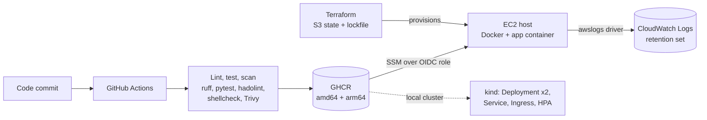
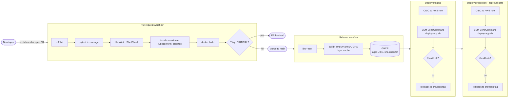
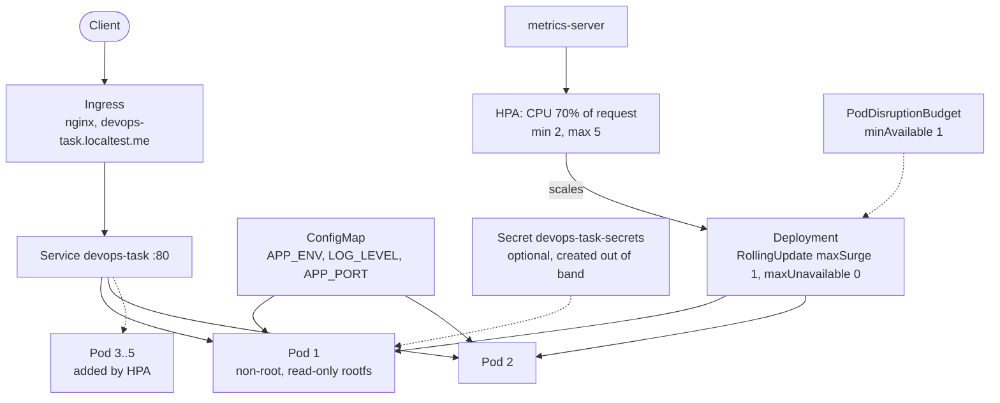
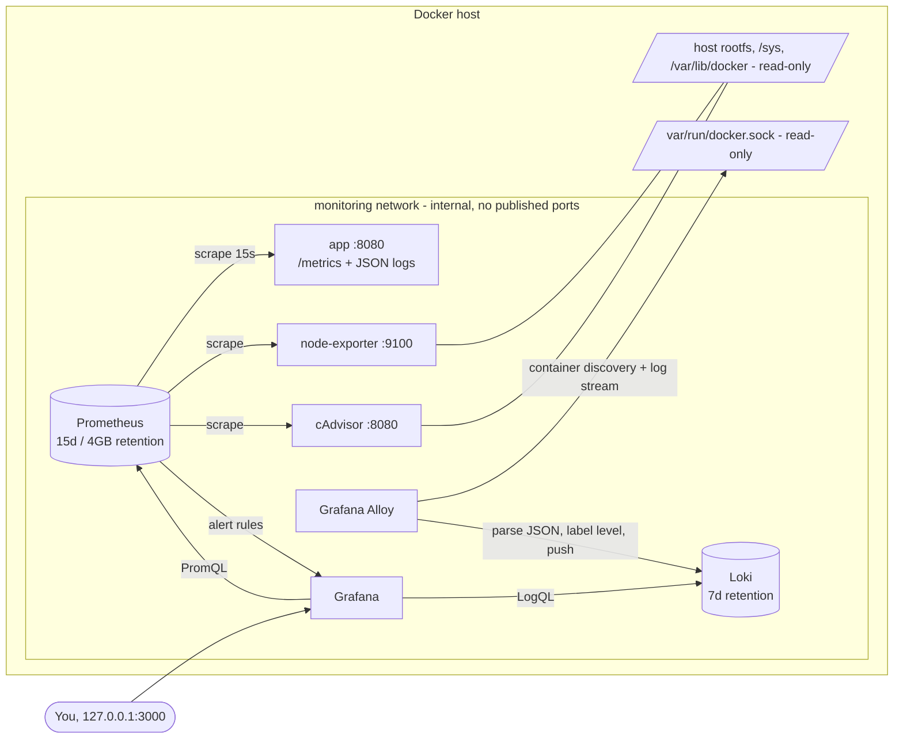

# Care Guide DevOps assessment

A small FastAPI service taken from source to a deployed, observable state: container image, CI/CD with security gates, AWS infrastructure in Terraform, a Kubernetes deployment, a six-component monitoring and logging stack, and a host health script.

I kept the application deliberately tiny so the effort goes into the delivery and operations around it.

**Read this first: what has and has not been run.** Parts of this were built in a sandbox that could not pull container images and had no AWS or Kubernetes cluster. [Verification status](#verification-status) lists, per component, what was actually executed and what is validated by static checks only. Nothing in this README is claimed as run unless it appears there.

## Contents

1. [Architecture](#architecture)
2. [Technology stack](#technology-stack)
3. [Prerequisites](#prerequisites)
4. [Repository structure](#repository-structure)
5. [Run the app locally](#run-the-app-locally)
6. [Docker](#docker)
7. [Docker Compose](#docker-compose)
8. [Tests](#tests)
9. [CI/CD](#cicd)
10. [GitHub secrets and variables](#github-secrets-and-variables)
11. [AWS with Terraform](#aws-with-terraform)
12. [Kubernetes](#kubernetes)
13. [Observability](#observability)
14. [Linux health script](#linux-health-script)
15. [Security considerations](#security-considerations)
16. [Deployment and rollback strategy](#deployment-and-rollback-strategy)
17. [Design decisions and trade-offs](#design-decisions-and-trade-offs)
18. [Monthly AWS cost estimate](#monthly-aws-cost-estimate)
19. [Troubleshooting](#troubleshooting)
20. [What I would improve with more time](#what-i-would-improve-with-more-time)
21. [AI tools usage](#ai-tools-usage)
22. [Verification status](#verification-status)

A longer walkthrough written to help explain every part in conversation is in [docs/TECHNICAL_GUIDE.md](docs/TECHNICAL_GUIDE.md).

## Architecture

End to end, from a commit to a running container on EC2:



CI/CD in detail. Pull requests are gated; every push to `main` publishes an immutable image and rolls it through staging, then production:



Kubernetes (local kind cluster, the same manifests port to EKS, see [below](#how-this-changes-on-eks)):



Observability data flow. Everything except Grafana lives on an internal Docker network:



## Technology stack

| Area | Choice | Why |
|---|---|---|
| Service | Python 3.13, FastAPI, uvicorn, prometheus-client | Small surface, first-class async, the Prometheus client is the reference implementation. |
| Image | Alpine-based multi-stage build, non-root | See [distroless vs Alpine](#distroless-vs-alpine). |
| CI/CD | GitHub Actions, GHCR, Trivy, Hadolint, ShellCheck | Everything runs where the code lives; no extra system to operate. |
| Cloud | AWS EC2, SSM, CloudWatch Logs, S3 | Smallest thing that satisfies the brief. See [EC2 vs ECS vs EKS](#ec2-vs-ecs-vs-eks). |
| IaC | Terraform >= 1.10 | S3-native state locking, no DynamoDB table needed. |
| Orchestration | Kubernetes via kind, Kustomize | Plain YAML with one overlay mechanism; no templating language to learn. |
| Metrics | Prometheus, Node Exporter, cAdvisor | Standard trio. |
| Logs | Grafana Alloy, Loki | Alloy is Grafana's supported collector (Promtail is end of life). |
| Dashboards | Grafana, provisioned from files | Reviewable in git, reproducible. |

## Prerequisites

| Needed for | Tools |
|---|---|
| App and tests | Python 3.13 |
| Containers, Compose, monitoring | Docker Engine 24+ with Compose v2 |
| Kubernetes demo | `kind`, `kubectl` (Docker must be running) |
| Terraform | Terraform >= 1.10, AWS CLI, an AWS account |
| Linting (optional locally, enforced in CI) | `shellcheck`, `hadolint`, `ruff` (comes with `requirements-dev.txt`) |

## Repository structure

```
.
├── app/                      FastAPI service (main.py, config.py, logging_config.py)
├── tests/                    pytest suite plus shell tests for the scripts
├── Dockerfile                multi-stage Alpine image
├── docker-compose.yml        the app on :8080
├── docker-compose.monitoring.yml   overlay adding the six-component stack
├── .github/workflows/        pr.yml (gates) and release.yml (publish + deploy)
├── terraform/
│   ├── bootstrap/            state bucket + GitHub OIDC provider (applied once)
│   ├── modules/app_host/     EC2, security group, IAM, CloudWatch, cloud-init
│   ├── modules/github_deploy_role/   OIDC role that may only SSM into one instance
│   └── environments/{staging,production}/
├── k8s/                      Kustomize manifests, kind config, k8s/README.md
├── monitoring/               prometheus, loki, alloy, grafana (provisioning + dashboards)
├── scripts/
│   ├── system_health.sh      host health check
│   ├── systemd/ and cron/    five-minute scheduling
│   ├── ci/ssm_deploy.sh      deploy driver used by the pipeline
│   └── k8s_demo.sh           rolling update and rollback demo
├── docs/                     architecture diagrams, evidence, technical guide
├── .env.example  Makefile  VERSION  requirements*.txt
```

## Run the app locally

```bash
python -m venv .venv && source .venv/bin/activate
pip install -r requirements-dev.txt
python -m app                      # listens on :8080
curl localhost:8080/               # {"message":"Hello from DevOps Task!","status":"running","version":"..."}
curl localhost:8080/health         # {"status":"ok","environment":"local"}
curl localhost:8080/metrics | head
```

Configuration is environment variables only (see `.env.example`):

| Variable | Default | Meaning |
|---|---|---|
| `APP_PORT` | `8080` | Listen port |
| `LOG_LEVEL` | `INFO` | DEBUG, INFO, WARNING, ERROR, CRITICAL. Anything else is rejected at startup. |
| `APP_ENV` | `local` | Environment name, added to every log line and to `/health` |
| `APP_VERSION` | `dev` | Returned by `/`. The image build sets it. |
| `ENABLE_FAULT_INJECTION` | `false` | When `true`, `GET /fault` returns a 500. Used to demo alerting. Never enable in production. |

Metrics exposed: `http_requests_total{method,path,status}`, `http_request_errors_total{method,path}` (5xx responses), and `http_request_duration_seconds` (histogram). The `path` label is the route template, and anything that matches no route is collapsed to `unmatched`, so scanners cannot create unbounded series. `/metrics` itself is not counted.

Logs are one JSON object per line on stdout, including uvicorn's own. SIGTERM triggers uvicorn's graceful shutdown: it stops accepting connections, lets in-flight requests finish, then runs the lifespan shutdown hook, which logs `service stopped`.

## Docker

```bash
make build                                  # docker build -t devops-task:local .
docker run --rm -p 8080:8080 devops-task:local
docker run --rm devops-task:local id        # uid=10001(app) gid=10001(app): not root
make image-size                             # prints the size
```

What the Dockerfile does:

- Two stages. The builder creates a virtualenv with the pinned requirements; the runtime stage copies only that venv and `app/`.
- Base image pinned to `python:3.13.7-alpine3.22` (a specific version, not a floating tag).
- `pip`, `setuptools` and `wheel` are removed from the runtime image, which shrinks it and takes their CVEs out of the scan.
- Runs as UID 10001, no login shell, no home directory.
- `HEALTHCHECK` uses Python's standard library, so no `curl` is installed just for that.
- OCI labels for title, description, version, revision, created and source. CI fills the build arguments.
- `.dockerignore` keeps git history, tests, Terraform, docs and local env files out of the build context.

**Final image size:** not measured in the authoring sandbox, because it could not pull the base image. CI measures it on every pull request and writes it to the job summary ("Image size 82.2 MiB"). To get it locally run `make image-size`.
<!-- IMAGE-SIZE: replace this note with the measured number after the first CI run or local build -->

## Docker Compose

```bash
cp .env.example .env
docker compose up -d --build
curl localhost:8080/health
docker compose ps                  # STATUS shows "healthy" after ~15s
docker compose down
```

The service has a healthcheck, `restart: unless-stopped`, CPU and memory limits (0.5 CPU, 128 MB), a read-only root filesystem, all capabilities dropped, `no-new-privileges`, and size-capped json-file logs.

## Tests

```bash
pip install -r requirements-dev.txt
ruff check .
pytest --cov                  # fails below 90% coverage
./tests/test_system_health.sh # health script: thresholds, exit codes, JSON, rotation
./tests/test_ssm_deploy.sh    # deploy driver: success, rollback, SSM failure, injection guard
```

Result of the last local run: 21 pytest tests passed with 100% coverage of `app/`; 26 assertions passed in the health script test and all cases passed in the deploy driver test. Raw output is in [docs/evidence/local-validation.txt](docs/evidence/local-validation.txt).

## CI/CD

Two workflows in `.github/workflows/`. All third-party actions are pinned to a full commit SHA with the version in a comment, and I checked each SHA against its tag. Dependabot keeps them current.

**`pr.yml`: every pull request.** Default permissions are read-only. Jobs run in parallel:

1. Lint with ruff, run pytest with coverage (XML and HTML uploaded as an artifact, summary in the job page).
2. Hadolint on the Dockerfile.
3. ShellCheck on every script, then the script tests.
4. Config validation: `terraform fmt -check` and `terraform validate` for every Terraform root, kubeconform on the manifests, `promtool check config` and `promtool test rules` on the Prometheus config and the alert unit tests, and `docker compose config`.
5. Build the image, print its size, show a HIGH/CRITICAL Trivy report for information, then a second Trivy run that fails the job on any CRITICAL finding. Unfixed vulnerabilities are ignored (there is nothing to do about them), so the gate fails only on things that can actually be fixed by upgrading.

**`release.yml`: every push to `main`.**

1. Re-run lint and tests.
2. Build `linux/amd64` and `linux/arm64` with Buildx and QEMU, with the GitHub Actions cache for layers, and push to GHCR. Provenance and SBOM attestations are enabled.
3. Tags: a semantic version and `sha-<short commit>`. `VERSION` holds `MAJOR.MINOR` (edited by hand for feature releases) and the workflow appends the run number as the patch, giving `1.0.37`. Every build gets a unique, ordered version and no tag is ever re-pointed. There is deliberately no `latest`.
4. `deploy-staging` then `deploy-production` (production waits for staging and for the approval rule on the `production` GitHub Environment, if configured). Each one assumes an AWS role through OIDC, runs `scripts/ci/ssm_deploy.sh`, and then smoke-tests `/health` from the runner.

Deploy jobs only run when the repository variable `AWS_DEPLOY_ENABLED` is `true`, so the pipeline publishes images and stays green before any AWS infrastructure exists.

How a deploy works: `ssm_deploy.sh` uses SSM `SendCommand` to run `/usr/local/bin/deploy-app.sh deploy <image>` on the instance (installed by cloud-init). That script records the currently running image, starts the new container, polls `/health` for up to 60 seconds, and on failure restarts the previous image. The exit code says what happened (0 deployed, 1 failed and rolled back, 2 failed with nothing to roll back to, 4 rollback failed too), and the workflow fails on anything but 0. There is no SSH and no open port 22.

### GitHub secrets and variables

No long-lived credentials exist anywhere. The AWS role is assumed through OIDC, and GHCR pushes use the built-in `GITHUB_TOKEN`.

| Name | Kind | Where | Purpose |
|---|---|---|---|
| `AWS_DEPLOY_ENABLED` | variable | repository | Set to `true` once AWS is provisioned. Leave unset to publish only. |
| `AWS_REGION` | variable | each environment | e.g. `us-east-1` |
| `AWS_ROLE_ARN` | variable | each environment | Output `github_deploy_role_arn` of the Terraform stack |
| `EC2_INSTANCE_ID` | variable | each environment | Output `instance_id` |
| `APP_URL` | variable, optional | each environment | e.g. `http://<public_ip>:8080`; enables the external smoke test |
| `GITHUB_TOKEN` | automatic | | Pushes the image (`packages: write` on the publish job only) |

Create two GitHub Environments, `staging` and `production`, and put the variables there so each environment points at its own role and instance. The IAM role trust policy is pinned to `repo:<owner>/<repo>:environment:<name>`, so a job in the staging environment cannot assume the production role. Add required reviewers on `production` for a manual approval step.

Make the GHCR package public after the first publish (Package settings, Change visibility) so the instance can pull without credentials. The image contains no secrets. For a private image see the `registry_token_ssm_parameter` variable.

## AWS with Terraform

Layout and ordering:

```
terraform/bootstrap/           once per account: versioned, encrypted, private S3 state bucket + GitHub OIDC provider
terraform/modules/app_host/    EC2 + SG + IAM role/profile + CloudWatch log group + cloud-init
terraform/modules/github_deploy_role/
terraform/environments/staging|production/
```

Staging and production are two root modules calling the same modules with different inputs (instance size, log retention 14 vs 90 days, memory limit), each with its own state key. Using separate directories instead of workspaces keeps state and variables visibly separate and lets production be applied independently.

State is in S3 with `use_lockfile = true` (native S3 locking; needs Terraform 1.10+ and removes the DynamoDB table). The bucket is versioned, encrypted, and blocks public access.

```bash
# 1. once per account
cd terraform/bootstrap
cp terraform.tfvars.example terraform.tfvars   # set state_bucket_name
terraform init && terraform apply
# note the outputs: state bucket, OIDC provider ARN

# 2. per environment
cd ../environments/staging
cp backend.hcl.example backend.hcl             # bucket + region
cp terraform.tfvars.example terraform.tfvars   # github_repository, OIDC ARN, allowed CIDRs
terraform init -backend-config=backend.hcl
terraform plan -out=tfplan
terraform apply tfplan

# 3. wire up GitHub with the outputs (see the table above), then push to main

# tear down when finished (staging first; the state bucket last)
terraform destroy
```

What gets created per environment: one EC2 instance in the default VPC (or a VPC you pass in) with an encrypted gp3 root volume, IMDSv2 required; a security group allowing only the app port from `allowed_ingress_cidrs` (there is no default; you must choose, and there is no port 22); an IAM role limited to `logs:CreateLogStream` and `logs:PutLogEvents` on this app's log group, plus the AWS-managed SSM core policy so SSM can reach the instance; an instance profile; a CloudWatch log group with explicit retention; and the OIDC deploy role described above.

cloud-init installs Docker, writes `/etc/app/*.env` and `deploy-app.sh`, and starts the first container when `initial_image` is set. The app container's logs go to CloudWatch through Docker's `awslogs` driver, which uses the instance role.

**Status.** `terraform fmt` was checked (with OpenTofu 1.10.6, because HashiCorp's download site is not reachable from the sandbox). `terraform validate` and `plan` were **not** run: they need to download the AWS provider, which the sandbox could not do, and `plan` also needs AWS credentials. CI runs `terraform fmt -check` and `terraform validate` for every root on each PR. Nothing was applied to AWS. Run `terraform init` once and commit the generated `.terraform.lock.hcl`.

## Kubernetes

Manifests are in `k8s/` (Kustomize). Full commands, prerequisites, and the demo are in [k8s/README.md](k8s/README.md). Summary:

- Deployment: 2 replicas, `RollingUpdate` with `maxSurge: 1, maxUnavailable: 0` (a new pod must pass readiness before an old one is removed), liveness and readiness on `/health`, requests 50m CPU / 64Mi and limits 250m / 128Mi, `preStop` sleep so the Service stops routing before SIGTERM arrives.
- Security context: non-root UID 10001, `readOnlyRootFilesystem`, all capabilities dropped, no privilege escalation, `RuntimeDefault` seccomp, `/tmp` as a small `emptyDir`.
- Service, Ingress (nginx, host `devops-task.localtest.me`, or `kubectl port-forward` without a controller), ConfigMap, HPA on CPU (70% of the request, 2 to 5 replicas), PodDisruptionBudget (`minAvailable: 1`).
- Secrets: the Deployment reads an optional Secret `devops-task-secrets`; no secret is committed. The service has no secret inputs today, but the wiring is there. Locally you create it with `kubectl create secret`; see below for production.

Run the whole demonstration (initial deploy, zero-downtime rolling update with a client polling `/health` every 200 ms, a deliberately broken rollout, and `kubectl rollout undo`):

```bash
scripts/k8s_demo.sh        # writes the transcript to docs/evidence/k8s-demo.txt
scripts/k8s_demo.sh cleanup
```

**Status.** The manifests pass `kubeconform -strict` (8 of 8 valid against the Kubernetes 1.33 schemas). The demo script was **not executed** in the authoring sandbox (no way to pull the kind node image), so there is no rollout output here yet; running the script produces it. I did not paste invented output.

### Rolling update and rollback

```bash
kubectl -n devops-task set image deploy/devops-task app=devops-task:1.1.0
kubectl -n devops-task rollout status deploy/devops-task
kubectl -n devops-task rollout history deploy/devops-task
kubectl -n devops-task rollout undo deploy/devops-task      # back to the previous revision
```

### How this changes on EKS

| Concern | Local | EKS |
|---|---|---|
| Ingress | ingress-nginx on kind | AWS Load Balancer Controller: an `Ingress` with `ingressClassName: alb` provisions an ALB, with `target-type: ip` so the ALB targets pods directly and the readiness probe drives health. TLS from ACM. |
| Secrets | `kubectl create secret` | AWS Secrets Manager as the source of truth, synced by the External Secrets Operator (`ExternalSecret` creates the `devops-task-secrets` Secret). Nothing sensitive in git. |
| Pod IAM | none needed | IAM Roles for Service Accounts (or EKS Pod Identity) bind the `devops-task` ServiceAccount to a least-privilege role, so ESO and the app never use node credentials. |
| Capacity | fixed kind nodes | Karpenter (or Cluster Autoscaler) adds nodes when the HPA's new pods are unschedulable and removes them when idle. |
| Images | loaded into kind | pulled from ECR or GHCR; multi-arch image allows Graviton nodes. |
| Cluster add-ons | manual | metrics-server for the HPA, plus kube-prometheus-stack (the monitoring here becomes ServiceMonitors and PrometheusRules). |
| Releases | `kubectl set image` | GitOps (Argo CD or Flux) or a pipeline step doing `kubectl set image`/Helm, with `maxUnavailable: 0` and the PDB protecting during node drains. |

## Observability

All six components are in `docker-compose.monitoring.yml`, an overlay on the main compose file:

```bash
cp .env.example .env
# set GRAFANA_ADMIN_USER and GRAFANA_ADMIN_PASSWORD; set DOCKER_GID to: stat -c %g /var/run/docker.sock
echo "ENABLE_FAULT_INJECTION=true" >> .env       # optional, for the demo below
docker compose -f docker-compose.yml -f docker-compose.monitoring.yml up -d --build
```

Compose refuses to start without the Grafana credentials (`${VAR:?}`); there is no default password.

**Grafana:** http://localhost:3000, bound to `127.0.0.1` only, log in with the credentials you put in `.env`. The datasources (Prometheus, Loki) and all three dashboards are loaded from `monitoring/grafana/` at startup; nothing is configured through the UI. The Application dashboard is the home dashboard. Generate traffic:

```bash
for i in $(seq 1 200); do curl -s localhost:8080/ >/dev/null; curl -s localhost:8080/nope >/dev/null; done
for i in $(seq 1 60);  do curl -s localhost:8080/fault >/dev/null; sleep 0.5; done   # needs ENABLE_FAULT_INJECTION=true
```

| Component | Version | Role | Exposed to host |
|---|---|---|---|
| Prometheus | v3.5.0 | scrapes app, node-exporter, cAdvisor (and itself) every 15s; retention 15 days **and** 4 GB, whichever hits first | no |
| Loki | 3.5.0 | log store; 7 day retention enforced by the compactor | no |
| Grafana Alloy | v1.10.0 | Docker service discovery, streams container logs, parses app JSON, pushes to Loki | no |
| Node Exporter | v1.9.1 | host CPU, memory, disk, network | no |
| cAdvisor | v0.52.1 | per-container CPU, memory, network | no |
| Grafana | 12.1.0 | dashboards, explore | `127.0.0.1:3000` only |

Prometheus, Loki, Alloy, Node Exporter and cAdvisor sit on a Compose network with `internal: true`, so they publish no ports and have no route out. The app and Grafana also join the default network.

### Log label choices

Loki indexes labels, so every label value multiplies the number of streams. I index only what is bounded and used in nearly every query:

| Field | Stored as | Why |
|---|---|---|
| `container`, `service`, `compose_project`, `job` | indexed label | Bounded by the number of containers; needed to select a stream. |
| `level` | indexed label | Five possible values; "show me errors" is the most common filter. |
| `path`, `route`, `method`, `status`, `duration_ms` | structured metadata | Filterable in LogQL without indexing (`| route="/fault"`). A raw `path` is unbounded, `duration_ms` is effectively continuous, so none belong in the index. |
| `message`, `timestamp` | the line / the entry time | The app's own timestamp is used so logs and metrics line up. |

### Dashboards

| Dashboard | Source | Content |
|---|---|---|
| **Application** | app `/metrics` + Loki | Requests/s, 5xx ratio, p95, instances up; request rate by route; responses by status; 5xx rate and ratio; p50/p95/p99 latency; log volume by level; a **logs panel** filtered by `level` and a free-text variable, next to the metrics; currently firing alerts. |
| **Host** | Node Exporter | CPU busy and by mode, memory, load per core, uptime, disk usage per mountpoint, disk throughput, network in/out. |
| **Containers** | cAdvisor | CPU and working-set memory per container, **memory utilisation against the configured limit** (gauge and history), the limit itself, CPU throttling, network per container. |

Screenshots: see [[Application](docs/screenshots/application.png). Run `make screenshots` against a running stack to generate them, or capture them manually as described in that file.

### Alerting

Four Prometheus alert rules in `monitoring/prometheus/rules/alerts.yml`, covered by unit tests in `monitoring/prometheus/tests/alerts_test.yml` (`promtool test rules`). They show in Prometheus (`/alerts`, not published; use `docker compose exec prometheus ...` or add a temporary port) and in the Application dashboard's "Firing alerts" table. **There is no Alertmanager**, so nothing is sent anywhere; routing to Slack is listed under improvements.

| Alert | Condition | `for` | Reasoning |
|---|---|---|---|
| `AppInstanceDown` | `up{job="app"} == 0` | 1m | A single failed scrape is noise; four consecutive failures (15s interval) mean the instance is really gone. Critical because the service is unavailable. |
| `AppHighErrorRate` | 5xx / all requests > 5% over 5m, and more than 0.05 req/s | 5m | 5% is well above background noise for a service that normally returns almost no 5xx. The 5m window and `for` stop one blip from paging. The minimum-traffic clause prevents one failed request on an idle service reading as 100%. `/health` and `/metrics` are excluded so probes do not dilute the ratio. |
| `HostDiskUsageHigh` | any filesystem > 80% used | 10m | The brief's 80%. Computed like `df` (used / (used + available)) so it matches `system_health.sh`. Disk fills slowly, so 10m avoids flapping on temporary files. Tmpfs, overlay and similar are excluded. |
| `ContainerMemoryNearLimit` | working set / limit > 90% | 5m | Working set is what the OOM killer acts on; plain usage includes reclaimable cache and would alert early. 90% leaves room to act before an OOM kill; 5m skips brief spikes. Containers with no limit are skipped. |

### Privileged mounts and host access

| Component | Access | Why | Mitigation |
|---|---|---|---|
| Alloy | `/var/run/docker.sock` read-only, plus the socket's group via `group_add` | Docker service discovery and log streaming need the Docker API | The socket is effectively root on the host, even mounted `:ro` (the flag does not restrict API calls). Alloy runs as non-root and is on the internal network only. In production prefer a log driver (journald, awslogs) or a socket proxy. |
| Node Exporter | host `/` mounted read-only at `/host` (`rslave`) | to read the host's real filesystems | read-only, all capabilities dropped, `no-new-privileges`, read-only root, no host PID or network namespace |
| cAdvisor | `/`, `/sys`, `/var/run`, `/var/lib/docker`, `/dev/disk` read-only | walks cgroups and Docker storage to attribute usage per container | read-only mounts; **not** `privileged: true`. Core CPU, memory and network metrics do not need it; only optional ones such as OOM events do. |

### Investigating an error spike

Scenario: the Application dashboard shows the 5xx ratio rising and `AppHighErrorRate` is pending.

1. **Scope it on the dashboard.** "Error rate (5xx)" and "Responses by status code" show when it started and whether it is 500 or something else. "Request rate by route" shows which route; if one route holds all the errors it is a code path, if every route is affected it is the whole service or a dependency. The p95 panel tells you if latency rose at the same time (saturation) or not (a straight failure).
2. **Confirm in Prometheus** if you need exact numbers. `sum by (path) (rate(http_request_errors_total[5m]))` ranks the routes. `up{job="app"}` and `changes(process_start_time_seconds[1h])` show restarts (a crash loop looks like errors plus restarts).
3. **Open the logs in the same view.** The logs panel on the Application dashboard shares the time range. Set the `level` variable to `error`. Each line carries `route`, `status`, `duration_ms` and, for unhandled exceptions, the stack trace. In Explore: `{service="app", level="error"} | route="/fault"`. Use `sum by (level) (count_over_time({service="app"}[1m]))` for the shape over time, and correlate the first error timestamp with a deployment.
4. **Check whether it is the platform and not the code.** The Containers dashboard shows memory against the limit (an OOM-killed container restarts and drops requests) and CPU throttling. The Host dashboard shows disk and CPU pressure on the machine.
5. **If logs are missing, check the pipeline.** Alloy's UI is not published; look at `docker compose logs alloy` for discovery or push errors, and `docker compose logs loki`. Confirm the app is writing JSON (`docker logs devops-app`). If lines arrive but `level` is missing, the Alloy JSON stage failed to parse them.
6. **Act.** If it began at a release, roll back (see below) and then investigate; otherwise fix forward. Afterwards decide whether the alert threshold or the dashboard needed to show it sooner.

**Status.** The Prometheus, Loki and Alloy configuration was validated with the exact pinned versions, and the stack was exercised as plain processes. Grafana, Alloy's Docker discovery and cAdvisor's per-container series could not be exercised; see [Verification status](#verification-status).

## Linux health script

`scripts/system_health.sh` (Bash, `set -euo pipefail`, ShellCheck clean).

```bash
scripts/system_health.sh                       # text report, appends to ./health_log.txt
scripts/system_health.sh --json                # one JSON object per run
scripts/system_health.sh --disk 80 --cpu 90 --mem 85
scripts/system_health.sh --help
```

It reports CPU (sampled from `/proc/stat` over a window, default one second), memory in use excluding cache, every real mounted filesystem (pseudo and duplicate mounts skipped), load average with core count, and the top 5 processes by memory. Each entry is timestamped and appended to the log, which rotates by size (1 MiB default, 5 files kept: `health_log.txt.1` ... `.5`). `[WARNING]` and `[CRITICAL]` lines are printed when thresholds are crossed (stderr in `--json` mode so stdout stays valid JSON).

Exit codes: `0` healthy, `1` warning (a value reached its threshold), `2` critical (reached threshold + `--critical-offset`, default 10 points), `3` usage or data error. The script is read-only apart from the log file.

Example, real output from a run in the sandbox (this machine's `/opt/claude-code` volume really was at 93%):

```
=== 2026-11-10T19:37:21Z host=vm status=critical ===
cpu_used_pct=0.0
mem_used_pct=6.6 (530MB of 8022MB)
load_avg=0.27 0.16 0.06 cores=2
...
[CRITICAL] disk /opt/claude-code at 93% (critical >= 90%)
exit=2
```

Scheduling every five minutes, either way:

```bash
# systemd
sudo install -m 0755 scripts/system_health.sh /usr/local/bin/
sudo install -m 0644 scripts/systemd/system-health.{service,timer} /etc/systemd/system/
sudo systemctl daemon-reload && sudo systemctl enable --now system-health.timer

# or cron
sudo install -m 0644 scripts/cron/system-health.cron /etc/cron.d/system-health
```

Tested: `tests/test_system_health.sh` covers healthy and warning/critical exit codes by lowering thresholds, JSON validity, the five-process cap, log append, and rotation. 26 assertions, all passing.

## Security considerations

- **Secrets.** None in the repo. Grafana credentials come from `.env` (git-ignored, with a required-variable check in Compose). AWS access is through OIDC and instance roles; there are no access keys. Kubernetes reads an optional Secret created outside git. `.gitignore` excludes `.env`, `*.tfstate`, `*.tfvars`, and key files.
- **Image.** Minimal Alpine, non-root, pip removed, read-only root filesystem and no capabilities at runtime. Trivy fails the PR build on fixable CRITICAL vulnerabilities. Base image pinned; Dependabot proposes updates. Builds carry provenance and SBOM attestations.
- **IAM.** The instance role can write to one log group and use SSM. The GitHub role can only run `AWS-RunShellScript` on one instance, and its trust policy is pinned to one repository and one GitHub Environment. The state bucket is private, versioned and encrypted.
- **Network.** The security group opens only the app port, from CIDRs you choose; there is no SSH (SSM instead). IMDSv2 is required. Only Grafana is published by the monitoring stack, on loopback.
- **Pipeline.** Minimal `permissions`, write access only where needed, SHA-pinned actions, concurrency control so two releases never deploy at once, and the image reference is validated before it is interpolated into a remote shell command.
- **Known gap.** The app is plain HTTP; production should sit behind a load balancer with TLS.

## Deployment and rollback strategy

A change reaches production only after a PR has passed lint, tests, Hadolint, ShellCheck, config validation and the Trivy gate. On merge, one image is built once, tagged with an immutable version, and the same artifact is deployed to staging, then, after the approval gate, to production. Because tags are never reused and there is no `latest`, "what is running" is always a single exact version.

Rollback has three layers:

1. **Automatic, on the host.** `deploy-app.sh` keeps the previous image reference. If the new container is not healthy within 60 seconds it is replaced by the previous one and the job fails loudly.
2. **Automatic, in the pipeline.** The external smoke test runs after the SSM step. Add `deploy-app.sh rollback` as a follow-up on failure if you want the pipeline to revert a release that passes on-host checks but fails from outside.
3. **Manual.** Re-run the deploy workflow for an older commit, or run `deploy-app.sh rollback` on the instance through SSM. In Kubernetes: `kubectl rollout undo`.

A single instance means a deploy replaces the container, so there is a brief gap of a few seconds. That is an accepted limit of the EC2 variant; the Kubernetes variant is zero-downtime. See the trade-offs below.

## Design decisions and trade-offs

### Distroless vs Alpine

I chose Alpine. Distroless Python images are smaller on paper but tie you to Debian's Python version, have no shell for debugging, and make the multi-stage venv copy fragile (the interpreter and libc must match). Alpine is small, ships a shell for `docker exec` debugging, and the pure-Python dependencies here have no musl issues. The cost is musl compatibility risk if native wheels are added later; at that point I would switch to a Debian-slim or distroless base.

### EC2 vs ECS vs EKS

The brief asks for EC2 with SSM or SSH, so that is what the pipeline targets. For a single small service, EC2 plus Docker is the cheapest and most transparent option. I would not run EKS for one service (the control plane alone is about $73 a month). ECS on Fargate is what I would choose for production: no instances to patch, rolling deploys with built-in circuit-breaker rollback, ALB integration. The Kubernetes part exists to demonstrate the orchestration concepts and maps onto EKS as described above.

### Tagging

Immutable semantic version (`MAJOR.MINOR` from `VERSION` plus the run number) and `sha-<commit>`. The version is for humans and for deploys; the SHA gives exact traceability to a commit. No `latest`, because it makes rollback and audits ambiguous.

### Registry

GHCR, so the build needs only the built-in token and works before any AWS account exists. The cost is that the host pulls over the internet from a public package. ECR with the instance role would remove that (and the need for a public package), and is what I would use in an AWS-centric production setup.

### Secrets

Nothing long-lived. OIDC for CI to AWS; instance profile for the host; External Secrets Operator + Secrets Manager for Kubernetes in production. The `registry_token_ssm_parameter` option exists for a private image and keeps the token in SSM, never in Terraform state or the repo.

### Terraform layout

Separate root modules per environment, a shared module for the host. State in S3 with native locking instead of DynamoDB (one less resource). The OIDC provider lives in the bootstrap stack because it is one per account, not one per environment.

### Alerts in Prometheus, not Grafana

Rules in Prometheus are plain files that `promtool` can unit test in CI. Grafana-managed alerts would be harder to review and test. The trade-off is no notification routing until Alertmanager is added.

### Loki structured metadata for path

The brief wants request path available as a filter without exploding cardinality. Structured metadata does that: filterable, not indexed. It requires Loki 3 with the v13 schema, which this stack uses.

### Error counter separate from the request counter

`http_request_errors_total` counts 5xx only. 4xx are client mistakes and would make a scanner hitting random URLs look like an outage. They are still visible by status in `http_requests_total`.

## Monthly AWS cost estimate

Rough, for one production instance in `us-east-1`, on-demand, 730 hours, based on list prices as I remember them. Check the AWS Pricing Calculator before relying on it.

| Item | Assumption | $/month |
|---|---|---|
| EC2 `t3.small` | 2 vCPU, 2 GB | ~15 |
| EBS gp3 | 12 GB | ~1 |
| Public IPv4 address | 1 | ~4 |
| CloudWatch Logs | ~2 GB ingested, 90 day retention | ~1 to 2 |
| S3 + state | negligible | <1 |
| **Total, single instance** | | **~$22** |
| Add an Application Load Balancer | for TLS and health checks | +~$17 |
| Add a second instance in another AZ | availability | +~$20 |
| **Closer to a real production setup** | 2 instances + ALB | **~$60** |

Staging on a `t3.micro` is about $11 including IPv4, or free for the first 12 months within the Free Tier (instance hours there are now credit-based for new accounts; check your account's plan). The monitoring stack is not included, as it runs locally; hosting it would need roughly another instance, or Grafana Cloud's free tier.

## Troubleshooting

| Symptom | Likely cause and fix |
|---|---|
| `docker compose ... up` aborts with "set GRAFANA_ADMIN_USER in .env" | Intended. `cp .env.example .env` and set the credentials. |
| Alloy restarts with "permission denied" on the Docker socket | `DOCKER_GID` in `.env` does not match the socket's group. Set it to `stat -c %g /var/run/docker.sock`. |
| Grafana dashboards are empty | Generate traffic first (see Observability). In the Containers dashboard, empty means cAdvisor cannot see Docker: check the `/var/lib/docker` mount, and note Docker Desktop (macOS, Windows) runs containers in a VM so host-level mounts show the VM. |
| Containers dashboard shows no per-container data on Docker Desktop | Known cAdvisor limitation on Docker Desktop; use a Linux host or VM. |
| Port 8080 or 3000 already in use | Set `GRAFANA_PORT` in `.env`, or change the published port in `docker-compose.yml`. |
| App exits immediately on start | Invalid `LOG_LEVEL` or `APP_PORT`; the message names the variable. |
| `terraform init` cannot find the backend | Create `backend.hcl` from the example and run `terraform init -backend-config=backend.hcl`. |
| Deploy job fails with exit 5 | SSM could not reach the instance. Check the instance is "Online" in SSM Fleet Manager and that it has outbound internet. |
| Deploy job is skipped | Repository variable `AWS_DEPLOY_ENABLED` is not `true`. |
| HPA shows `<unknown>` | metrics-server is not installed; see `k8s/README.md`. |

## What I would improve with more time

- Run the stack and the Kubernetes demo on a real machine and commit the screenshots and transcripts (the biggest gap, see below).
- Alertmanager with Slack routing and a runbook link on every alert.
- Move the container onto ECS Fargate behind an ALB with TLS, or add a second instance behind a load balancer so a deploy is not a brief outage.
- Terraform: commit the provider lock file, add `tflint` and `checkov` to CI, and run a plan on every PR with a read-only role.
- Sign images with Cosign and verify the signature at deploy time.
- Package the manifests as a Helm chart, or adopt Argo CD for GitOps.
- Replace the mounted Docker socket with a socket proxy or a log driver.
- Add OpenTelemetry tracing with Tempo.
- Load test the HPA and tune its thresholds from real data.

## AI tools usage

I used an AI assistant (Claude) throughout this task: to draft and iterate on the application, Dockerfile, workflows, Terraform, manifests, monitoring configuration and dashboards, to troubleshoot problems, and to write this documentation. The assessment allows this. I reviewed the output, and the technical guide in `docs/TECHNICAL_GUIDE.md` is there so I can explain each part. The assistant ran the static checks, tests and tools listed in the verification section, and I have tried to say exactly where it could not run something rather than imply it did.

## Verification status

Legend: **Tested** = executed and passed. **Static** = configuration checked by a validator but not deployed. **Needs credentials** = requires an AWS account or GitHub. **Not run** = could not be executed in the authoring sandbox.

| Component | Check | Result |
|---|---|---|
| Application | `pytest --cov` | **Tested.** 21 passed, 100% coverage |
| Application | Live run: `/`, `/health`, `/metrics`, 404, 500, JSON logs, SIGTERM | **Tested.** Process exited cleanly and logged `service stopped` |
| Application | `ruff check`, `ruff format --check` | **Tested.** Clean |
| Docker | `hadolint Dockerfile` | **Tested.** No findings |
| Docker | Image build, non-root check, image size 82.2 MiB, healthcheck | **Not run.** No registry access for the base image. CI does the build and size; run `make build` locally |
| Compose | `docker compose config` (app + monitoring) | **Tested.** Valid. Start-up itself **Not run** |
| CI/CD | `actionlint` on both workflows | **Tested.** Clean |
| CI/CD | Action SHA pins vs upstream tags | **Tested.** 12 of 12 match |
| CI/CD | A real workflow run, Trivy scan, GHCR push | **Needs credentials.** The repo was not on GitHub from the sandbox |
| CI/CD | Deploy script logic (success, rollback, SSM failure, timeout, injection) | **Tested** with a stubbed AWS CLI (`tests/test_ssm_deploy.sh`). Not against real SSM |
| Terraform | `fmt -check` | **Tested** (OpenTofu 1.10.6) |
| Terraform | `validate`, `plan`, `apply` | **Not run** / **Needs credentials.** Provider download blocked; CI runs `validate` |
| Kubernetes | `kustomize build` + `kubeconform -strict` | **Tested.** 8 valid, 0 invalid |
| Kubernetes | Deploy, rolling update, rollback on kind | **Not run.** Node image not pullable. `scripts/k8s_demo.sh` does it |
| Prometheus | `promtool check config`, `test rules` | **Tested** with v3.5.0 (the pinned version) |
| Loki | `-verify-config` | **Tested** with 3.5.0 |
| Alloy | `alloy validate` | **Tested** with v1.10.0 |
| Metrics pipeline | Prometheus scraping the real app, node_exporter, cAdvisor as processes; all 34 dashboard queries and 4 alert expressions evaluated | **Tested** (see [docs/evidence/native-validation.txt](docs/evidence/native-validation.txt)); container series empty because there were no Docker containers |
| Logs pipeline | Alloy JSON parsing into Loki with the repo's pipeline block, `level` indexed | **Tested** from a file source. Docker discovery **Not run** |
| Grafana | Provisioning loads and renders dashboards; screenshots | **Not run.** Grafana could not be downloaded |
| Shell | `shellcheck` on all scripts | **Tested.** Clean |
| Shell | `tests/test_system_health.sh` | **Tested.** 26 passed |
